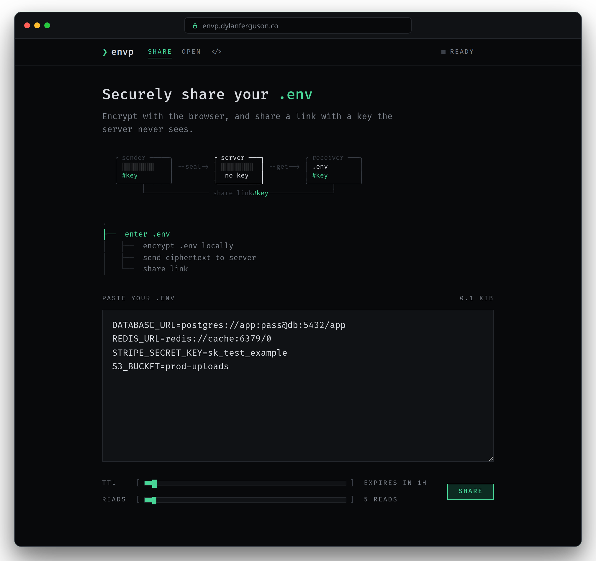

<p align="center">
  
</p>

<h1 align="center">envp</h1>

<p align="center">
  Securely share your .env<br>
  Encrypt with the browser, and share a link with a key the server never sees.
</p>

<p align="center">
  <a href="https://envp.dylanferguson.co">envp.dylanferguson.co</a>
</p>

<p align="center">
  
</p>

## Run locally

Install [Nix](https://docs.determinate.systems/) and [devenv](https://devenv.sh/getting-started/) (`nix profile add nixpkgs#devenv`), then start the UI and API:

```bash
devenv up
```

UI on [http://127.0.0.1:5173](http://127.0.0.1:5173), API on `:8080`. This talks to Go directly and has no per-IP cap. `devenv shell` gives you the toolchain and these commands: `check` (lint, including zizmor on the GitHub Actions workflows), `unit-tests`, `e2e-tests`, `smoke-tests`, `fuzz-tests`, `build-api` and `build-images`. `fuzz-tests` runs [Bombadil](https://github.com/antithesishq/bombadil) against the UI from `devenv up` for two minutes, or with the flags you pass, such as `fuzz-tests --time-limit 10m`. It needs Chrome installed. With direnv, run `direnv allow` to enter the shell automatically.

## Containers

```bash
devenv shell compose-up
```

Nix builds both images (`flake.nix`) and loads them into Docker as `envp:nix` and `envp-nginx:nix`. On macOS this needs a Linux builder, such as the one in [Determinate Nix](https://docs.determinate.systems/determinate-nix/linux-builder/).

App on [http://127.0.0.1:8080](http://127.0.0.1:8080). nginx serves the UI, rate-limits creates and reads, and proxies `/api` to Go on loopback `:8081`. SQLite lives on the named `envp-data` volume.

| Variable         | Default                                   |
| ---------------- | ----------------------------------------- |
| `PORT`           | `8080` (`8081` behind nginx)              |
| `LISTEN_HOST`    | all interfaces (`127.0.0.1` behind nginx) |
| `INTERNAL_PORT`  | `9090` (`/health`, `/metrics`)            |
| `DB_PATH`        | `./data/shares.db`                        |
| `PUBLIC_ORIGIN`  | derived from request                      |
| `X_ORIGIN_TOKEN` | `envp-dev-token` (compose) / fly secret   |

## Production

nginx requires an `X-Origin-Token` header that only Cloudflare sets (exiting at boot if unset), returns 403 for `*.fly.dev`, and rate-limits on `CF-Connecting-IP` (falling back to `Fly-Client-IP` and the socket peer).

Wire the edge token — both values must match:

```bash
fly secrets set X_ORIGIN_TOKEN=$(openssl rand -hex 24) -a envp
```

```bash
cf rulesets create --zone dylanferguson.co --body '{
  "name": "envp origin token",
  "kind": "zone",
  "phase": "http_request_late_transform",
  "rules": [{
    "description": "Set X-Origin-Token for envp",
    "expression": "http.host eq \"envp.dylanferguson.co\"",
    "action": "rewrite",
    "action_parameters": {"headers": {"X-Origin-Token": {"operation": "set", "value": "<same value>"}}},
    "enabled": true
  }]
}'
```
