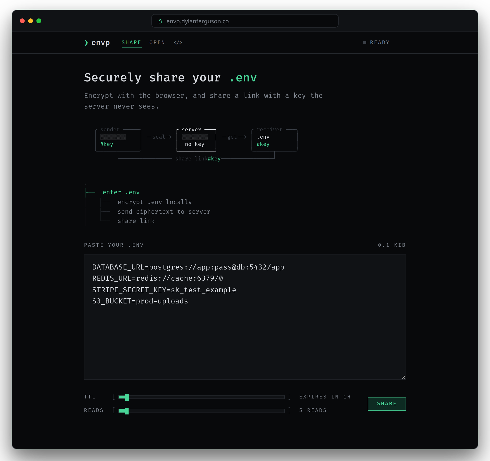

<p align="center">
  
</p>

<h1 align="center">envp</h1>

<p align="center">
  Securely share your .env<br>
  Encrypt with the browser, and share a link with a key the server never sees.
</p>

<p align="center">
  <a href="https://envp.dylanferguson.co">envp.dylanferguson.co</a>
</p>

<p align="center">
  
</p>

## Run locally

```bash
mise install
vp install
mise run dev
```

UI on [http://127.0.0.1:5173](http://127.0.0.1:5173), API on `:8080`. `mise run dev` talks to Go directly and has no per-IP cap. `mise run start` is the API without the UI.

## Docker

```bash
docker compose up --build
```

App on [http://127.0.0.1:8080](http://127.0.0.1:8080). nginx serves the UI, rate-limits creates and reads, and proxies `/api` to Go on loopback `:8081`. SQLite lives on the named `envp-data` volume.

| Variable         | Default                                   |
| ---------------- | ----------------------------------------- |
| `PORT`           | `8080` (`8081` behind nginx)              |
| `LISTEN_HOST`    | all interfaces (`127.0.0.1` behind nginx) |
| `INTERNAL_PORT`  | `9090` (`/health`, `/metrics`)            |
| `DB_PATH`        | `./data/shares.db`                        |
| `PUBLIC_ORIGIN`  | derived from request                      |
| `X_ORIGIN_TOKEN` | `envp-dev-token` (compose) / fly secret   |

## Production

nginx rate-limits on the client IP Fly's edge reports (`Fly-Client-IP`, honoring `CF-Connecting-IP` only when that edge IP is in a Cloudflare range), returns 403 for `*.fly.dev`, and requires an `X-Origin-Token` header that only Cloudflare sets, so direct-to-Fly traffic is rejected. Without the secret, nginx exits at boot (fail closed).

Wire the edge token — both values must match:

```bash
fly secrets set X_ORIGIN_TOKEN=$(openssl rand -hex 24) -a envp
```

```bash
cf rulesets create --zone dylanferguson.co --body '{
  "name": "envp origin token",
  "kind": "zone",
  "phase": "http_request_late_transform",
  "rules": [{
    "description": "Set X-Origin-Token for envp",
    "expression": "http.host eq \"envp.dylanferguson.co\"",
    "action": "rewrite",
    "action_parameters": {"headers": {"X-Origin-Token": {"operation": "set", "value": "<same value>"}}},
    "enabled": true
  }]
}'
```
